# PubSub Messaging System
The Instinct firmware uses a custom, zero-allocation Publish-Subscribe internal messaging system (`Instinct/Modules/Messaging/PubSub/`). Taking inspiration from systems like ROS 2 and PX4's uORB, it decouples different modules and domains by providing a centralized, unified way to exchange data. 

Topics, subscribers, and the broker use static storage owned by the modules that instantiate them, wired together via intrusive linked lists. Any module can read the latest message without blocking via `Peek()`, or poll for new updates via `Take(..., TX_NO_WAIT)`. This path has zero RTOS overhead, relying instead on a seqlock (an atomic `version` counter incremented to odd during writes and even on completion) and `dmb` memory barriers. Threads that need to sleep until new data arrives can use `Take(..., timeout)` which blocks on ThreadX event flags. Every `Topic<T>` also inherits from a type-erased `TopicBase` class exposing raw byte-level access (`CopyPayload` / `PublishRaw`), allowing fast binary telemetry (`InstinctLink`) and SD card logging (Blackbox) without knowing any message structs.

## Architecture

 

The PubSubs's fundamental building blocks are the `Broker`, `Topics`, `Messages`, and `Subscribers`. The core block is the `Topics`, which stores only the latest `Message` (latest-value semantics, no FIFO queue) and is uniquely identified by a 16-bit packed address `(instance << 8) | topicID`, where:

* **`TopicID` (low byte):** Identifies the  topic's message type defined in `topicIDs.hpp` (e.g., `Imu = 5`, `State = 50`, `Actuator = 70`). All message structures are defined under `PubSub/Messages/` and are `#pragma pack(push, 1)` byte-aligned.
* **`TopicInstance` (high byte):** Separates multiple physical sensors, supporting redundant sensors, and also virtual/fused outputs, simulated data, and reserved protocol planes:

| Instance Range | Constant | Purpose |
| :--- | :--- | :--- |
| `0x00` – `0xEF` | `Default` .. `MaxPhysical` | Physical hardware instances (e.g., IMU 0, IMU 1) |
| `0xF0` | `Virtual` | Fused, calibrated, or voted sensor output |
| `0xF1` | `Simulated` | HITL/SITL injected sensor data |
| `0xFE` | `All` | Wildcard for Broker/Blackbox batch operations (not registerable) |
| `0xFF` | `Protocol` | Reserved for `InstinctLink` RPC commands and logger metadata |

A publisher pushes a new message to a `Topic` by using a non-blocking `Publish(msg)` call (which briefly disables interrupts to keep the seqlock update atomic and compute publish-rate stats).

Subscribers (consumers) can read data in three ways:
* **`Peek(msg)`:** Always returns the latest value immediately without needing a `Subscriber`.
* **`Take(sub, msg, TX_NO_WAIT)`:** Lock-free poll that only returns `true` if a new message was published since the subscriber's last read (setting `sub->missedUpdates` if more than one publish occurred in between).
* **`Take(sub, msg, timeout)`:** Blocks the thread on a ThreadX event flag until `Publish()` wakes it.

For higher efficiency, subscribers that only poll (e.g., fixed-rate loops or `InstinctLink`'s parameter ACK listener) should subscribe with `enableEvent = false`. This skips creating a ThreadX event flag group and keeps them out of the notification list iterated during `Publish()`.

The `Broker` maintains a linked list of all registered `Topics`, allowing flight modules to look up typed topics via `GetTopic<T>(TopicID, instance)` or `GetTopicByName<T>(name)`, while providing type-erased `TopicBase*` access for streaming, logging, and diagnostics.

**Lifetime Note:** Because `Broker` and `Topic` store raw pointers in intrusive linked lists, `Topic` instances should be `static`/global, and any `Subscriber` must either live for the full thread lifetime or call `Unsubscribe()` before going out of scope.

## Additional Modules

### Binary Blackbox Logging (`BlackboxConfig`)
Each topic has an independent `logEnabled` flag and rate divider (`logPeriodUs`). When enabled via `Broker::EnableLogging(...)`, `Publish()` pushes the packed 16-bit topic address and raw struct directly to `Logger::Instance().LogData(...)`. This results in a very fast, raw binary, data logging stream directly from the PubSub system.

### Data stream with HITL support (`InstinctLink`)
Running in an independent thread detached from the core PubSub logic, `InstinctLink` streams topics out and injects topics in over a data link (e.g., UART) using a lightweight binary frame (`0x55AA` sync + 16-bit ID + length + payload + XOR CRC). Up to 16 topics can be streamed out (via `CopyPayload()`) at configurable rates. Received/inbound packets with IDs below `0xFF00` are injected directly into matching topics (via `PublishRaw()`) for HITL/SITL and offboard control support. IDs `0xFF00` and above are interpreted and executed as RPC commands, used to configure the streams, discover/list topics, and read/write parameters via [`ParamService`](./parameters.md).

### MAVLink Bridge (`MavlinkThread`)
Another independent thread peeks topics at a configurable rate, translates them into standard MAVLink messages, and transmits them over a data link (e.g. UART) for compatibility with tools like QGroundControl.

## Example Code

```cpp
#include "pubSub.hpp"

// Publisher (Producer): Instantiate and register once at boot, then just publish
static Topic<IMUMsg> topicImu("imu_0", static_cast<uint8_t>(TopicID::Imu), 0);

void SensorInit() {
	Broker::RegisterTopic(&topicImu);
}

void SensorLoop() {
	IMUMsg msg{};
	msg.timestamp = Time::GetUs();
	// ... populate accel/gyro ...
	topicImu.Publish(msg);
}

// Subscriber (Consumer): Look up topic and subscribe (enableEvent = true for blocking, false for polling)
void EstimatorLoop() {
	Topic<IMUMsg>* imuTopic = nullptr;
	while (imuTopic == nullptr) {
		imuTopic = Broker::GetTopic<IMUMsg>(TopicID::Imu, 0);
		tx_thread_sleep(10); // Wait for producer registration at boot
	}

	Subscriber<IMUMsg> imuSub;
	imuTopic->Subscribe(&imuSub, true);

	IMUMsg msg{};
	while (true) {
		if (imuTopic->Take(&imuSub, msg, TX_WAIT_FOREVER)) {
			// Process latest IMU sample
		}
	}
}
```
